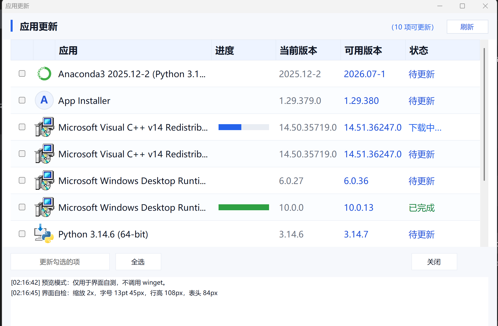

# 应用更新

一个给 Windows 用的桌面批量更新器：把 `winget` 命令包成能勾选、能看进度、关掉窗口也不中断的小工具。



## 它是什么

Windows 自带的「Microsoft Store」只更新商店应用，`winget upgrade` 又只有命令行。这个工具把两者之间那段空隙补上：

- 列出 winget 能升级的程序，勾选后批量更新
- 顺带扫描「Windows 更新 → 可选更新 / 驱动」
- 装不上但有官网的程序（国产软件、驱动、MATLAB 这类）单独列出，双击直接打开下载页
- 不需要管理员权限安装；程序自己提权，也不会闪黑框

## 功能

| 功能 | 说明 |
|---|---|
| 批量更新 | 勾选 → 二次确认 → 后台逐个执行，实时状态回填到表格 |
| 阶段进度 | 下载中 / 安装中 / 完成 / 失败，进度条按阶段填充 |
| 关窗口不中断 | 更新跑在独立后台进程里，关掉界面照样继续，结果写进日志 |
| Windows 可选更新 | 通过 Windows Update 接口扫描可选更新和驱动，和 winget 结果并列 |
| 需手动项 | 从注册表读已装版本，给出官网入口，双击打开；不参与全选 |
| 免弹窗 | 所有提示都写到窗口底部日志，不弹对话框 |
| 高 DPI | 200% 缩放下不模糊（自己算缩放，不依赖 WinForms 自动缩放） |

## 系统要求

- Windows 10 / 11
- Windows 10 1809 以上自带的 **App Installer（winget）**，没有的话去 [aka.ms/getwinget](https://aka.ms/getwinget) 装
- 不需要预装 PowerShell 模块，只用 `System.Windows.Forms`

## 安装

```powershell
git clone https://github.com/<你的用户名>/<仓库名>.git
cd <仓库名>
powershell -ExecutionPolicy Bypass -File .\install.ps1
```

装完桌面上会多一个「应用更新」。卸载跑 `uninstall.ps1` 就行。

> 也可以只下载 `update-gui.ps1` 和 `job-runner.ps1` 手动放到 `%LOCALAPPDATA%\UpdateCheck\`，但不建快捷方式就得自己记路径。

## 使用

1. 双击「应用更新」，会弹一次 UAC —— winget 升级系统级软件需要管理员
2. 列表自动刷新（winget 可升级项 + 系统可选更新 + 需手动项并行加载）
3. 勾选要更新的项目 → 点「更新勾选的 N 项」→ 按钮变成「确认更新 N 项？」→ 再点一次才执行（防手滑，5 秒内有效）
4. 想看某个程序的新版本，双击那一行打开官网

## 配置：manual-updates.tsv

「需手动」那几项来自这个文件，一行一个，Tab 分隔：

```
名称 <TAB> 源(reg/dev) <TAB> 匹配(正则) <TAB> 已知最新版本(可空) <TAB> 网址 <TAB> 图标路径(可空，支持通配符)
```

| 字段 | 说明 |
|---|---|
| 源 | `reg` = 按卸载记录里的 DisplayName 匹配；`dev` = 按显卡驱动 DriverDesc 匹配 |
| 匹配 | 正则，例如 `^Zotero$` |
| 已知最新版本 | 填了就和已装版本比对：不一致显示「有新版本」，留空显示「需手动」 |
| 图标路径 | 留空会自动从 DisplayIcon / 安装目录取；驱动类可以写通配符 |

## 设计说明

- **界面**：PowerShell + WinForms，没有第三方依赖。200% 缩放下 WinForms 的自动缩放不可靠（TableLayoutPanel 的绝对行高不会跟着缩放），所以关掉自动缩放，所有尺寸自己乘 DPI 系数
- **后台执行**：界面把队列写进 `job\queue.txt`，`job-runner.ps1` 作为独立进程执行，通过 `job\status.txt` / `job\done.txt` 回传状态；关掉界面不影响它
- **阶段进度**：winget 只在终端里画百分比，输出重定向后就不打了，所以进度只能做到「下载中 / 安装中」两段，靠解析 winget 的实时输出判断
- **免弹窗**：所有结果都写日志窗口，不放 MessageBox

## 已知限制

- **没有真实下载百分比**：winget 不对外提供，最多做到阶段
- **Windows 更新扫描需要管理员**：非管理员运行时这一路会失败，只影响可选更新
- **驱动和国产软件装不了**：winget 没有它们的更新源，只能列出 + 给官网
- **msstore 源**：如果查询很慢，可以 `winget source remove msstore`（商店应用本来由系统自己更新）

## 目录结构

```
update-gui.ps1        界面 + 逻辑（主程序）
job-runner.ps1        后台批量执行 winget / Windows 更新
wu-scan.ps1           扫描 Windows 可选更新与驱动
launch.vbs            静默提权启动（避免黑框）
manual-updates.tsv    需手动更新的条目配置
icon80.ico            图标
install.ps1           安装
uninstall.ps1         卸载
```

## License

MIT
